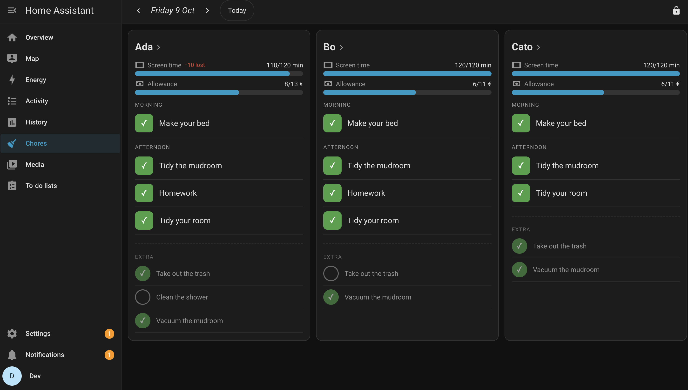

# Chores and Rewards for Home Assistant

> ⚠️ **This integration is 100% vibe coded.** It was written by an AI (Claude Code), guided by a human who wrote the spec and reviewed the results. It has a large test suite, but **use it at your own risk.** No warranty, no support promises, and the author takes no responsibility for lost screen time, allowance disputes or anything else (see the MIT license).

A weekly chores board for a kitchen touchscreen, running entirely inside Home Assistant. Kids tick off their own chores. Parents set up the rules and settle the week with a PIN. There is no gamification: just progress bars and done/not done.



## Key concepts
- **Kids:** as many as you like. Each gets a column on the overview, a week view, and one HA device with balance sensors.
- **Currencies:** you define what chores earn, for example *screen time* (whole minutes) or *weekly allowance* (€ with cents). Each currency has:
  - a payout day;
  - whether missed chores can **cost** it;
  - a weekly cap, either a **fixed max** (screen time never goes above it) or the **sum of the week's chores** (allowance is whatever was on offer).
- **Chores:** each chore has weekdays, a time of day (morning / afternoon / anytime), the kids it's for, and a value per currency. There are two types:
  - **Expected:** a duty. A missed one can cost.
  - **Bonus:** optional. It only ever earns and is never shown as a failure. It earns one currency: payment (e.g. allowance), or, after a bad day, the kid can pick to win back lost screen time instead. A bonus can be **once a day**: the first kid to do it takes it. An expected chore like homework can be **ticked ahead**, up to the end of next week.

## How a week works
1. Each day the screen shows every kid's chores. A tap ticks a chore at once, with no approval. Forgotten ticks can be fixed any day that week; they are flagged as late for the parent.
2. At midnight, undone expected chores become *missed*. If HA was off, it catches up.
3. On a currency's payout day, the parent opens **Payouts**, sees each kid's amount, and ticks it as paid or entered.
4. Monday 00:00 closes the week automatically. Nothing carries over.

**Parent mode** (🔒 → PIN):
- fix any chore in the open week: done, excused or reject;
- adjust a balance (a note is required);
- payouts;
- manage kids, currencies, chores and settings;
- an audit log of everything, with filters, that can replay the full history.

Also:
- a "Clean hands?" reminder when the screen wakes;
- Norwegian and English;
- uses your HA theme.

## Install
1. Copy `custom_components/chores_and_rewards` to `/config/custom_components/`, or add this repo to HACS as a custom *Integration* repository.
2. Restart HA, then go to **Settings → Devices & services → Add integration → Chores and Rewards**, and pick a parent PIN.
3. Open **Chores** (**Gjøremål** in Norwegian) in the sidebar, unlock with the PIN, and set things up under **Manage**.

Notes:
- **Tablet user:** the tablet can run as any HA user. Use a non-admin user if kids shouldn't reach HA's settings.
- **Changing the PIN:** integration ⋮ → **Reconfigure**.
- **Data:** stored in `/config/chores_and_rewards.db`, which is included in HA backups.

## How it was built
1. **Spec:** a human wrote a short spec covering what the app should do, not how. It was shaped by research on chores and motivation (no leaderboards, feedback only). See [`docs/spec.md`](docs/spec.md).
2. **Plan:** the AI researched HA integration patterns, then turned the spec into a 10-step plan with acceptance criteria and a decision log for every gap in the spec.
3. **Build:** each step was built, tested, committed and recorded in [`docs/ledger.md`](docs/ledger.md): what was built, how, what went wrong, and what was decided. That log was the bookkeeping across the whole build, including later user requests (fixing past days, a replayable audit log, a database review, a full code review).

Other docs:
- [`docs/decisions.md`](docs/decisions.md): decisions D1–D48.
- [`docs/database.md`](docs/database.md): tables and relations.
- [`docs/ws-api.md`](docs/ws-api.md): the WebSocket API.
- [`docs/ui-layout.md`](docs/ui-layout.md): the screen layout.

## Development
```sh
script/setup     # Python 3.14 venv
script/develop   # HA in Docker on :8123; then: .venv/bin/python script/dev_onboard.py && script/dev_seed.sh
script/check     # lint + types, pytest (incl. audit replay), JS unit + render smoke, browser E2E
```

MIT licensed. Use at your own risk.
