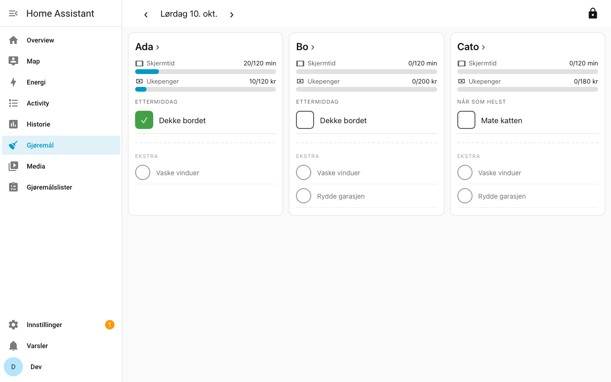

# Chores and Rewards for Home Assistant

A weekly chores board for a kitchen touchscreen, running entirely inside Home Assistant.
Kids tick off their own chores. Expected chores earn (or can cost) screen time and
allowance, while bonus chores only ever earn. A parent PIN unlocks fixes, payouts and setup.

There is no gamification: no leaderboards, badges, streaks or confetti. Just progress bars and done/not done.
See [`chores-app-spec.md`](chores-app-spec.md) for the why.



## Features
- **Today overview:** one column per kid, with chores grouped morning / afternoon / anytime and muted bonus chores at the bottom. You can browse the days of the current week.
- **Week view per kid:** a Monday–Sunday grid showing done ✓, missed ✗ and excused –.
- **Currencies you define:** each has a payout day, "can be lost" yes/no, and a cap. The cap is either a fixed weekly max (e.g. screen time) or the sum of the week's chores (e.g. allowance).
- **Midnight rollover:** undone expected chores become missed. The week closes automatically on Monday, and catch-up runs if HA was off.
- **Parent mode (PIN):**
  - reject, excuse or mark done on any day of the open week;
  - adjust balances with a note;
  - payouts per currency;
  - manage kids, chores, currencies and settings;
  - an audit log.

  The PIN locks after 5 minutes, and repeated wrong PINs lock it out for longer each time.
- **"Clean hands?" reminder** when the screen wakes from idle.
- **Balance sensors** (`sensor.<kid>_<currency>`) for automations and dashboards.
- Norwegian (default) and English. Uses your HA theme.

## Install
**Manual:** copy `custom_components/chores_and_rewards` into `/config/custom_components/` and restart Home Assistant.

**HACS (custom repository):** in HACS go to ⋮ → Custom repositories, add this repo as an *Integration*, install it, and restart.

Then go to **Settings → Devices & services → Add integration → Chores and Rewards** and choose a parent PIN (4–8 digits).
"Gjøremål" appears in the sidebar.

### First steps
1. Open **Gjøremål** and tap the 🔒 (top right), then enter the PIN.
2. Go to **Administrer**:
   - add your kids;
   - check the two starter currencies (Skjermtid, Ukepenger) and set a weekly max for screen time;
   - add chores: expected or bonus, time of day, weekdays, kids, and the value per currency.
3. Lock again. The kids can now tick off chores on the overview.

### The kitchen tablet
The tablet can run as any Home Assistant user. Running it as an **admin** lets anyone reach HA's settings from the sidebar. If you don't want that, use a normal user (parent actions are protected by the PIN either way). Kiosk or fullscreen browser mode works well.

### Resetting the PIN
**Settings → Devices & services → Chores and Rewards → Configure** (HA admin only). This also logs out any open parent sessions and clears lockouts.

### Data
Everything is stored in `/config/chores_and_rewards.db` (SQLite) and included in HA backups. Removing the integration keeps the file.

## Development
```sh
script/setup        # Python 3.14 venv + test deps
script/test         # pytest + node unit tests (node via Docker if not installed)
script/smoke        # render smoke test of the panel (happy-dom, in Docker)
script/lint         # ruff + mypy
script/develop      # HA 2026.10 in Docker on :8123
.venv/bin/python script/dev_onboard.py && script/dev_seed.sh   # login dev/dev, PIN 1234, demo data
script/e2e          # browser E2E (Playwright) against a throwaway HA on :8124
script/check        # all of the above + lint; run before every push
```
For E2E: `pip install -r requirements_e2e.txt && python -m playwright install --only-shell chromium`.

Project docs:
- `CLAUDE.md`: conventions
- `LEDGER.md`: build log
- `docs/decisions.md`: decisions that fill gaps in the spec
- `docs/acceptance.md`: acceptance criteria
- `docs/ws-api.md`: the WebSocket API
- `docs/ui-layout.md`: the agreed screen layout

## License
MIT
