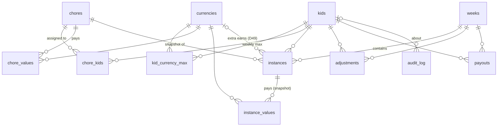

# Database

One SQLite file, `/config/chores_and_rewards.db`, included in HA backups. Every table is `STRICT`, the schema version is kept in `PRAGMA user_version`, and the file is stamped with `PRAGMA application_id` (an unstamped older file is set aside and recreated, not migrated). Amounts are integers in the currency's minor unit (`currencies.decimals`: 2 means cents, D50). The conventions are listed at the top of `db.py` (D45).

**Migrations:** `MIGRATIONS[i]` upgrades version i to i + 1, each in one transaction, after a backup to `chores_and_rewards.db.bak-v<i>`. v1 is the v0.1.0 schema; v2 adds `once_a_day` to `chores` and `instances` (D51). Released entries are never edited.

## Tables

| Table | What it holds |
|---|---|
| `kids`, `currencies`, `chores` | Configuration, edited by a parent. `currencies.decimals` (0–2) is fixed once the currency exists. They are soft-deleted (`deleted_at`) so history stays intact. Active names are unique, ignoring case. `chores.once_a_day` marks an extra only one kid can do per day (D51). |
| `kid_currency_max` | An optional weekly max per kid and currency (used by the fixed cap, D4). |
| `chore_kids`, `chore_values` | Which kids a chore is for, and what it pays in each currency. `chores.weekdays` is a bitmask (bit 0 = Monday). |
| `weeks` | One row per week, keyed by its Monday. Status is `open` or `closed`. |
| `instances` | One row per **kid × chore × day**: the thing a kid ticks. Name, type, slot and `instance_values` are a **snapshot** of the chore when the row was created, so later edits never rewrite history (D6). Status is `pending`, `done`, `missed`, `excused` or `rejected`. A done extra chore stores the one currency it earns in `currency_id` (NULL = all values; only set when done, D49). `once_a_day` is part of the snapshot. Ids are never reused (AUTOINCREMENT). |
| `adjustments` | Parent corrections (±) to a balance, with a required note. |
| `payouts` | The "paid / entered" tick per week, kid and currency. It stores the amount at that moment (D11). |
| `audit_log` | Append-only history of every change, with kid, day and a late flag. The full state can be replayed from it (D46). |
| `settings`, `meta` | Panel settings (JSON values), and the rollover marker `last_finalized`. |

## Derived, never stored
- **Balances** are computed from instances, adjustments and caps (`views.week_balances`). The order is: earned is capped, then losses are subtracted, extra chores that won back a loss are added (at most the loss), then adjustments, and the total is clamped to `0..cap` (D5, D49).
- **Late ticks:** a done row whose `status_at` falls on a later local day than the row's own day.

## Rules kept by the schema
- `instances.week` must be the Monday of `day` (a CHECK constraint).
- A closed week must have `closed_at`, and any status other than `pending` must have `status_at`.
- Booleans are 0/1, dates and timestamps must be valid, amounts have sign checks, and all foreign keys are enforced.
